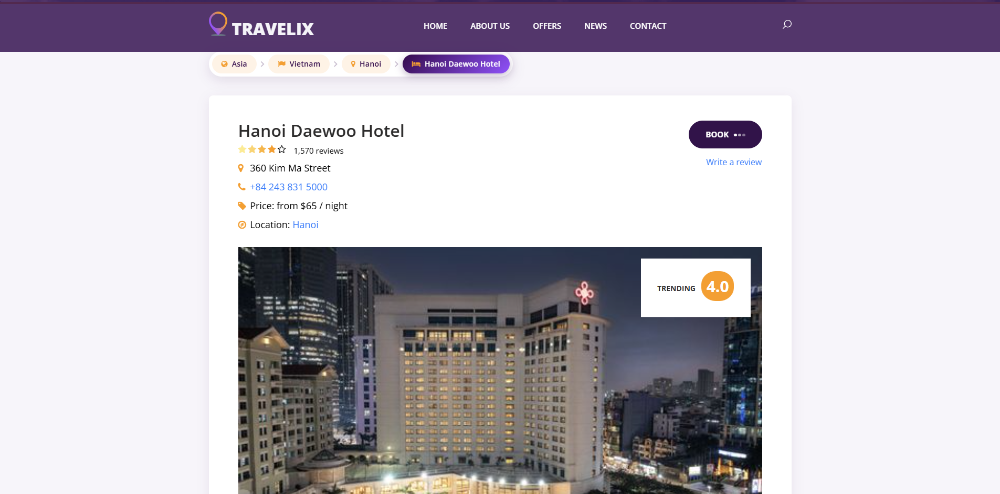
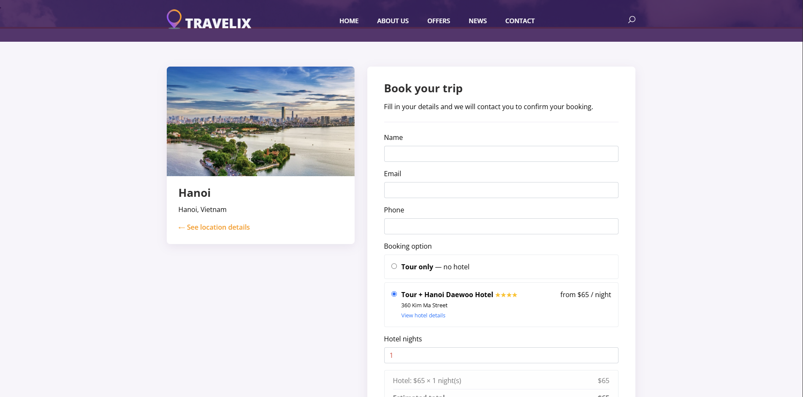
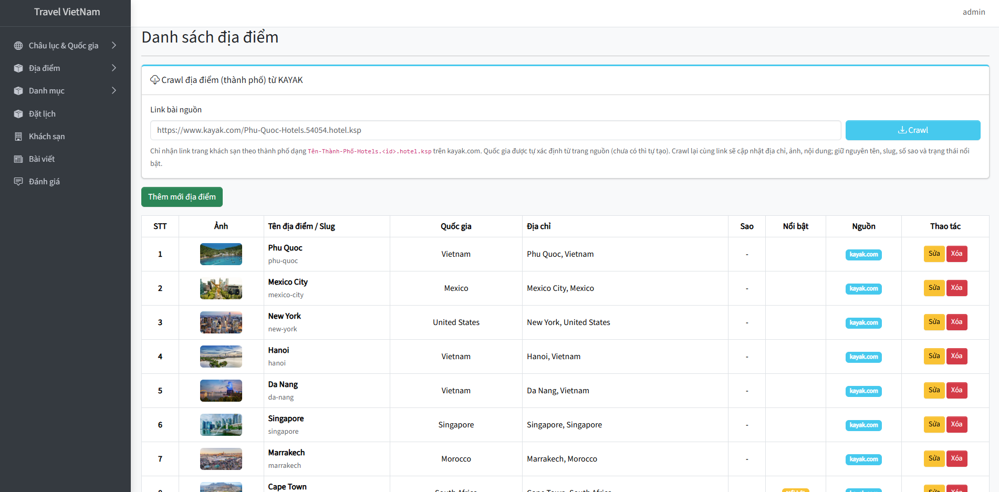
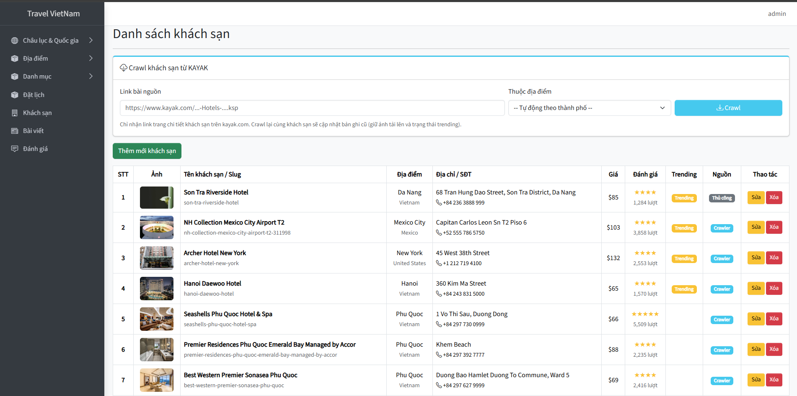
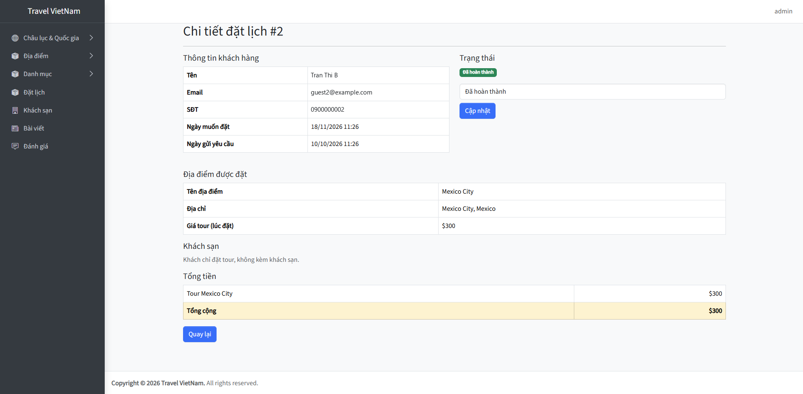

# 🌏 TravelVN — Website du lịch & Trang quản trị

Website đặt tour du lịch gồm **trang khách hàng** và **trang quản trị (Admin Panel)**, kèm **crawler tự động thu thập dữ liệu** khách sạn, địa điểm, bài viết.

**Công nghệ:** PHP 7+ · CodeIgniter 3 · MySQL · Bootstrap · jQuery · Symfony DomCrawler

| | |
|---|---|
| 🌐 **Trang khách hàng** | [Xem chức năng ↓](#-trang-khách-hàng) |
| 🔐 **Trang quản trị (Admin)** | [Xem chức năng ↓](#-trang-quản-trị-admin-panel) |
| 🕷️ **Crawler dữ liệu** | [Xem chi tiết ↓](#️-crawler-thu-thập-dữ-liệu) |
| 🔑 **Tài khoản admin demo** | `admin` / `123456` |

---

## 🌐 Trang khách hàng


- **Trang chủ:** slider, địa điểm nổi bật, bài viết mới
- **Duyệt theo cấp:** Châu lục → Quốc gia → Thành phố → Khách sạn
- **Tìm kiếm** địa điểm
- **Chi tiết địa điểm, khách sạn:** gallery ảnh, tổng hợp đánh giá của khách (guest insights)
- **Đặt tour / khách sạn:** chọn số đêm, **tự tính tổng tiền**
- **Tin tức / Blog:** bài viết kèm thông tin tác giả
- **Đánh giá:** chỉ khách **đã có đơn hoàn thành** mới được viết đánh giá, và đánh giá chỉ hiện sau khi admin duyệt
- **Liên hệ, Giới thiệu**

| Chi tiết khách sạn | Đặt chỗ |
|---|---|
|  |  |

---

## 🔐 Trang quản trị (Admin Panel)

Đăng nhập tại **`/login`**, tài khoản demo **`admin` / `123456`**.



- **Đăng nhập, phân quyền:** mật khẩu mã hóa bằng `password_hash`, kiểm tra session và role ở `Admin_Controller` ([MY_Controller.php](application/core/MY_Controller.php))
- **Quản lý (thêm / sửa / xóa, phân trang):** Địa điểm · Châu lục · Quốc gia · Danh mục · Khách sạn · Bài viết
- **Quản lý đơn đặt chỗ:** xem chi tiết, đổi trạng thái *Chờ xác nhận → Đã xác nhận → Hoàn thành*
- **Duyệt đánh giá:** duyệt hoặc ẩn đánh giá trước khi hiện lên trang khách
- **Crawl dữ liệu ngay trong admin:** dán URL, bấm *Crawl*
- **Cron job:** tự động chuyển các đơn đã qua ngày sang *Hoàn thành*

| Quản lý khách sạn (kèm form Crawl) | Chi tiết đơn đặt chỗ |
|---|---|
|  |  |

---

## 🕷️ Crawler thu thập dữ liệu

Crawler viết bằng **Symfony DomCrawler** ([application/controllers/crawler/Brand.php](application/controllers/crawler/Brand.php)):

- Thu thập **châu lục, quốc gia, thành phố, khách sạn, bài viết, tác giả**
- Đọc dữ liệu có cấu trúc **JSON-LD (schema.org)**, tự tải ảnh về máy
- Tự liên kết phân cấp: `continents > countries > places > hotels`
- Tổng hợp đánh giá của khách thành *guest insights* cho từng khách sạn

> Dữ liệu được thu thập chỉ phục vụ mục đích học tập.

---

## 🗂️ Cấu trúc chính

```
application/
├── controllers/      # Home, Places, Hotels, Bookings, Reviews, Posts, Login...
│   └── crawler/      # Crawler dữ liệu
├── models/           # Truy vấn database
├── views/
│   ├── site/         # Giao diện khách hàng
│   └── admin/        # Giao diện quản trị
└── core/             # MY_Controller.php: Admin_Controller (kiểm tra đăng nhập)
database/
├── travel_hn.sql     # Database đầy đủ + dữ liệu mẫu
└── migrations/       # Lịch sử thay đổi cấu trúc DB
```

## ⚙️ Cài đặt và chạy

**Yêu cầu:** PHP 7.4+, MySQL 5.7+ / 8, Composer (ví dụ dùng Laragon hoặc XAMPP)

```bash
# 1. Tải code
git clone https://github.com/duyyybngng2207-png/travelvn.git
cd travelvn

# 2. Cài thư viện (Symfony DomCrawler cho crawler)
composer install
```

3. Tạo database tên `travel_hn`, rồi import file `database/travel_hn.sql`
4. Kiểm tra cấu hình kết nối trong `application/config/database.php` (mặc định: `root`, mật khẩu rỗng)
5. Sửa `base_url` trong `application/config/config.php` cho đúng địa chỉ chạy trên máy, ví dụ `http://localhost/travelvn/`
6. Mở trình duyệt:
   - Trang khách hàng: `http://localhost/travelvn/`
   - Trang admin: `http://localhost/travelvn/login` → `admin` / `123456`

---

👤 **Tác giả:** Nguyễn Duy Bằng · GitHub [@duyyybngng2207-png](https://github.com/duyyybngng2207-png)
